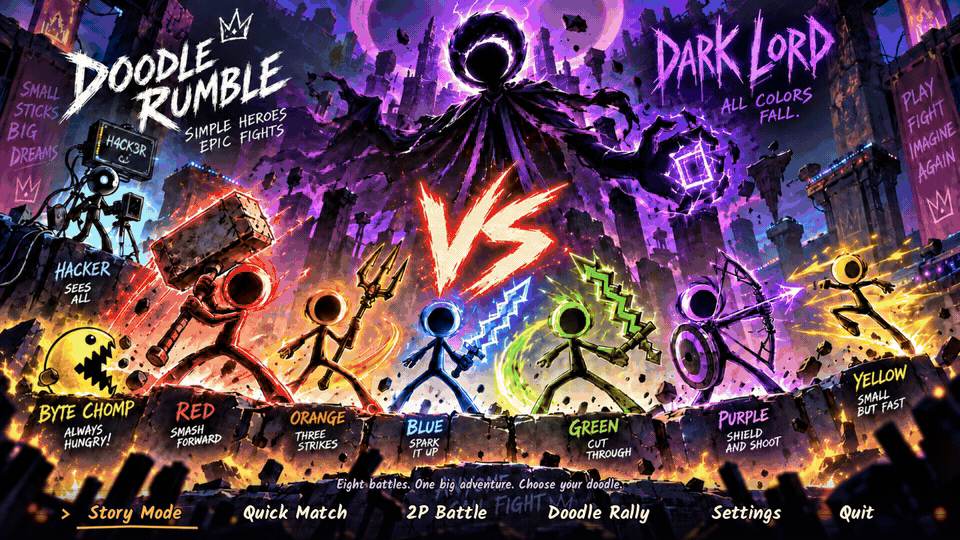

# Five-gag title motion release verification — v0.7.13

2026-10-11. Godot 4.7.2, Universal Mac build 31. Source, native and export verification ran on Apple M4 with isolated preferences.

## Change

The title starts with The Underline Heist, then rotates through four shorter vignettes: a guitar-string “boing,” a sleepy moustache doodle with a popping bubble, a peekaboo whack, and a hiccup chain reaction. The full loop is 47.9 seconds after the 2.6-second greeting. Existing poster art, menu controls, hitboxes and callbacks are preserved. Reduced motion still holds a static menu pose. No gameplay, saves, dependencies or racing code changed.

## Source and native results

| Verification | Result |
| --- | --- |
| Headless Godot import | Passed, no errors or warnings |
| Source menu suite | 168 checks, zero failures |
| Native title-motion fixture | 42 checks, 965 captures, zero failures |
| Actual 854×480 source window | Two checks, one capture, zero failures |
| Actual 854×480 exported-pack window | Two checks, one capture, zero failures |
| Release archive-policy tests | Six tests passed |
| Diff whitespace | Passed |

The native fixture samples the complete introduction and five-gag cycle, verifies stable menu hitboxes, focus/hover/navigation, reduced-motion stillness, scene cleanup and re-entry. The small-window fixture checks the resized native root window. The preview GIF is a 50.53-second 960×540 capture at 15 fps. These are automated and rendered checks; physical controllers, Intel hardware, transfer to a second Mac and family/virality playtesting were not tested.

## Exact Mac export

Exported the v0.7.13 Universal app as build 31. The exact embedded PCK passed **175 checks / zero failures**: test_menus.gd (168), test_game.gd --live-fuse-only (five), and the native exported-pack small-window fixture (two). The live two-round fight ended 2–0, Purple at 42 HP, with no retries.

Both arm64 and x86_64 executable slices are present. Strict local ad-hoc signature verification passed, and the exported executable completed an isolated 120-frame headless startup without errors. The app is ad-hoc signed and not Apple-notarized. ZIP/source archive integrity, checksums, and public GitHub asset state are recorded in BUILD_STATUS.md after publication.
